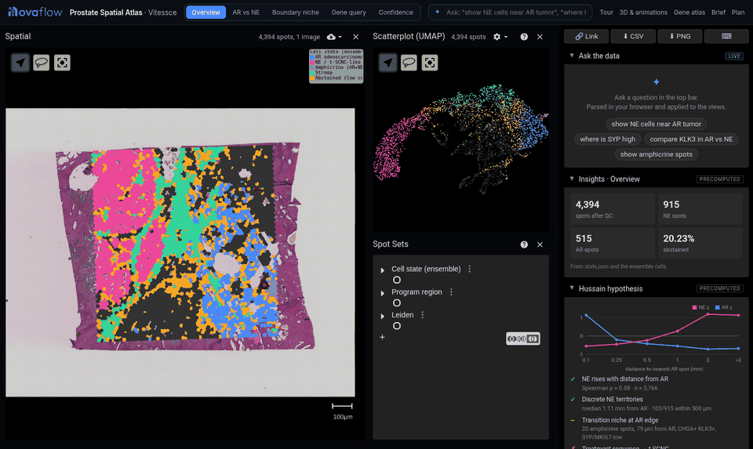
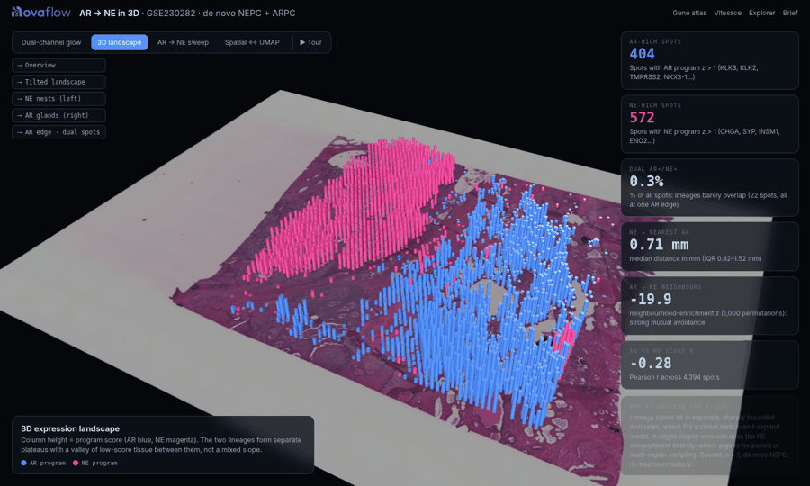

# Prostate Spatial Atlas: AR → NE lineage in space

**Live:** https://logan196.github.io/hussain-prostate-spatial-demo/

This is an interactive spatial-transcriptomics portal for **GEO GSE230282 / GSM7211257**: one Visium CytAssist FFPE prostate sample in which de novo neuroendocrine prostate cancer (NEPC) sits alongside AR-driven adenocarcinoma (Watanabe et al., *IJMS* 2023). It was built as call prep for Dr. Maha Hussain (Northwestern) on treatment-emergent small-cell NE prostate cancer (t-SCNC).



## v2 (branch `v2-live-llm`): live LLM + hypothesis tests computed on the data

**Preview:** see the Vercel preview link in the PR / handoff note. The GitHub Pages site above is unchanged until this branch is merged.

- **Live LLM.** Questions in the top bar (and `?q=` share links) go to `api/ask.js`, a Vercel serverless function that calls Anthropic's Messages API with one forced tool, `respond`. The model returns structured JSON: a short answer, how it mapped the question onto this data ("cells" are Visium spots, "core 3" is Leiden cluster 3), view changes (preset, colour by gene or score, highlight spot groups, zoom) and up to 3 tests with their groups and parameters. It never returns a statistic.
- **Tests computed in your browser** (`v2/stats.js` in a Web Worker, over the served zarr matrix and spot table):
  - `proximity`: mean nearest distance from group A to group B, label-permutation null (all spots, or only among A and B spots), one-sided p for closer and for farther.
  - `nhood_enrichment`: squidpy-style A-B contact count on a 130 µm radius graph, label-permutation z and p.
  - `co_occurrence`: squidpy co-occurrence ratio p(A | within d of B) / p(A) over distance, plus a permutation p at one distance.
  - `wilcoxon`: rank-sum test of one gene between two groups (scipy defaults), with AUC and log2FC, and a note that spots are not independent replicates.
  - Every card shows the statistic, the null, p, n, permutations and seed, the method and caveats. Permutations use a seeded generator, so a result is reproducible.
- **Distance scale.** v2 calibrates micrometres from the array itself (median spot centre spacing = 100 µm Visium pitch: 14.51 hires px, 6.892 µm/px). v1 used 55 µm / `spot_diameter_fullres` (5.387 µm/px), which puts the spot pitch at 78 µm, so v1 distances (for example "median NE to AR 1.11 mm") read about 22% short. The precomputed v1 panels are left as they were.
- **Key handling.** The Anthropic key lives only in the Vercel env var `ANTHROPIC_API_KEY` of the project. It is never in the client or the repo. Without it the app says so, falls back to the v1 rule parser, and the test buttons still run.
- **Rate limit.** Per IP 8 requests/min and 120/day, plus 600/hour per instance, input capped at 600 characters and 900 output tokens. In memory per warm instance by default; set `UPSTASH_REDIS_REST_URL` and `UPSTASH_REDIS_REST_TOKEN` for a limit shared across instances. Optional: `ANTHROPIC_MODEL`, `RL_PER_MINUTE`, `RL_PER_DAY`, `RL_GLOBAL_PER_HOUR`, `ALLOWED_ORIGINS` (default `https://logan196.github.io`).
- **Run locally:** `ANTHROPIC_API_KEY=... node scripts/dev-server.mjs 8765`, then open http://localhost:8765/.
- **Verify:** `python verify/verify_tests.py . results_browser.json out` recomputes every browser result with squidpy 1.8.2 (`nhood_enrichment`, `co_occurrence`), scipy (`mannwhitneyu`, `cKDTree`) and an exact replica of the browser's seeded permutations. `node --test test/*.test.mjs` runs the engine unit tests.
- **Limits.** One section from one patient, spot-level statistics, descriptive only. The label-shuffle null does not preserve tissue architecture.

## What's in it
| Page | What it is |
|---|---|
| `index.html` | **Vitessce 3.5 core.** H&E (pyramidal OME-TIFF) + UMAP + spot sets + all 18,939 genes, lazily loaded per 40-gene zarr chunk. It has 5 presets (Overview, AR vs NE, Boundary niche, Gene query, Confidence) and a natural-language ask box. The right panel holds LIVE answers and PRECOMPUTED insights, the hypothesis panel and the ensemble cell-state calls. |
| `atlas.html` | Gene atlas, one page per gene (`#/gene/KLK3`): HGNC metadata, a zoomable overlay, expression by region and cluster, NE-vs-AR Wilcoxon stats, top correlates and provenance. |
| `showcase.html` | deck.gl 3D and animations: AR/NE glow map, extruded landscape, AR→NE sweep, spatial↔UMAP morph. |
| `brief.html`, `Novaflow_Hussain_Plan.pdf` | Call brief and the 4-page plan with references. |
| `explorer.html` | The earlier Plotly viewer (337 genes), kept for comparison. |



### Using the core viewer
- **Ask**: e.g. `compare KLK3 in AR vs NE`, `NE spots within 300 µm of AR`, `where is chromogranin high` (aliases and fuzzy symbols work), or `genes correlated with SYP`. In v1 the parser runs in your browser and is rule-based; in v2 the question goes to the live LLM and the rule parser is the fallback. Each answer is computed from per-spot data and shown with the intent it parsed.
- **Share**: the URL always encodes the view (`?preset=conf`, `?q=compare%20KLK3%20in%20AR%20vs%20NE`, `?preset=gene&gene=SYP`). The 🔗 button copies it.
- **Export**:
  - CSV of every spot: ensemble call, voter agreement, distance to AR, region, the current gene and the query group, with a provenance header.
  - PNG of the spatial view.
- **Keys**: `1`–`5` switch presets, `/` focuses the ask box, `S` copies the link, `E` exports CSV, `P` exports PNG, `?` shows help. The tour is under **Tour** (or `?tour=1`).

## Honesty rules
- **LIVE** = computed in the browser for your query. **PRECOMPUTED** = taken from `stats.json` and the ensemble produced by `analysis.py`.
- **Abstention gating**: 5 voters (thresholds, relaxed thresholds, spatial smoothing, GMM, cluster profile) each call every spot. A label is kept only if ≥4/5 agree; otherwise the spot is **Abstained**. That happens for 889 spots (20.23%). The **Confidence** preset maps per-spot agreement.
- **Limits**: this is one patient with de novo NEPC and no treatment history. The treatment-sequence → t-SCNC hypothesis is shown as **not testable** with these data. All statistics are spot-level and descriptive.

## Reproduce
```bash
pip install scanpy squidpy scikit-misc leidenalg igraph anndata zarr tifffile
python analysis.py          # downloads GSE230282 from GEO if missing → stats.json, figures/
python build_atlas.py       # atlas/ shards
python build_vitessce.py    # vitessce/data.zarr, pyramidal he.ome.tif, spots.json
python -m RangeHTTPServer 8765   # the OME-TIFF needs HTTP Range support
```

## Quality checks
- `node ci/lint.mjs`: syntax-checks every inline script and runs htmlhint.
- `python ci/smoke.py http://localhost:8765/`: drives headless Chromium through 9 page states and **fails on any console error or HTTP ≥400**. The only allowlisted errors are zarr.js `.zarray` group probes.
- The GitHub Actions workflow is in `ci/github-workflow-ci.yml`. To enable it, move it to `.github/workflows/ci.yml` (pushing workflow files requires a token with the `workflow` scope).
- The audit log is in [`docs/AUDIT.md`](docs/AUDIT.md), and changes are in [`CHANGELOG.md`](CHANGELOG.md).

## Provenance & citation
- **Data**: GEO [GSE230282](https://www.ncbi.nlm.nih.gov/geo/query/acc.cgi?acc=GSE230282), sample GSM7211257 (10x Visium CytAssist, FFPE).
- **Primary paper**: Watanabe R, et al. *Spatial gene expression analysis reveals characteristic gene expression patterns of de novo neuroendocrine prostate cancer coexisting with androgen receptor pathway prostate cancer.* **Int J Mol Sci** 2023;24(10):8955. doi:[10.3390/ijms24108955](https://doi.org/10.3390/ijms24108955), PMID [37240308](https://pubmed.ncbi.nlm.nih.gov/37240308/).
- **Software**:
  - Vitessce (Keller et al., *Nat Methods* 2025) and deck.gl.
  - scanpy (Wolf et al., *Genome Biol* 2018) and squidpy (Palla et al., *Nat Methods* 2022).
  - Gene metadata from HGNC.
- **Derived values**: everything shown is computed from the public data by the scripts in this repo. Nothing is simulated.

Please cite the primary paper and GEO accession if you reuse the data. Cite this repo as: Beharry L. *Prostate Spatial Atlas (GSE230282 demo)*, v1.0, 2026. https://github.com/logan196/hussain-prostate-spatial-demo

Portal styling is adapted from Logan's `advocate-health-portal` (Novaflow theme).
